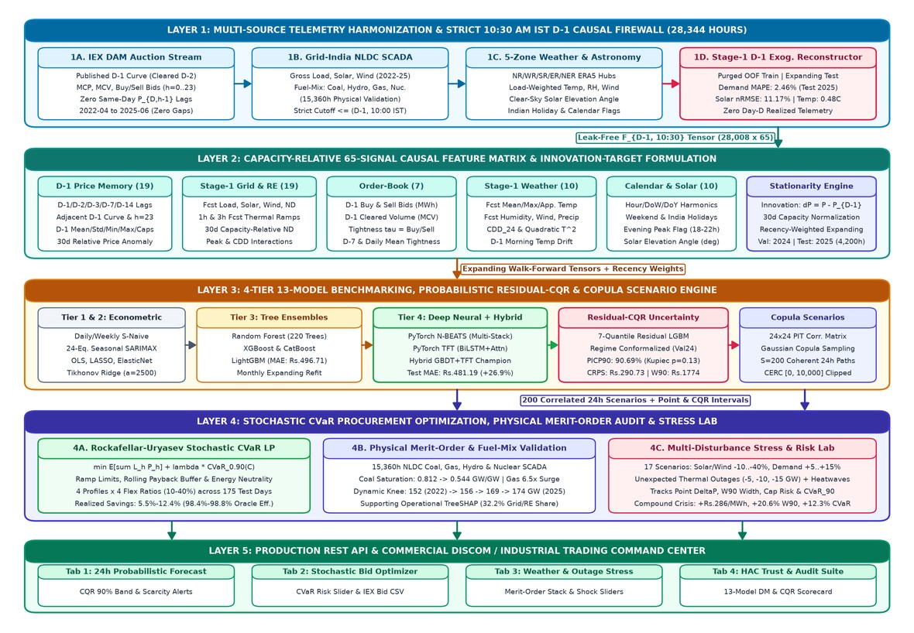

# EnergyCast

**Causality-Aware Electricity Price Forecasting, Probabilistic Risk Quantification & Stochastic CVaR Procurement Optimization for the Indian Energy Exchange (IEX DAM)**

[](https://vinay3579-code.github.io/EnergyCast/)
[](https://www.python.org/)
[](https://pytorch.org/)
[](https://lightgbm.readthedocs.io/)

EnergyCast is an end-to-end decision-support platform for **State DISCOMs**, **open-access industrial consumers**, and **BESS operators** bidding into India's blind uniform-price Day-Ahead Market before the **10:30 AM IST (D-1)** gate closure. Trained and validated on **28,344 hourly records** (April 2022 – June 2025) combining IEX DAM auctions, Grid-India (POSOCO) NLDC SCADA telemetry, and 5-zone demand-weighted ERA5 weather, it pairs leak-free multi-tier forecasting with calibrated uncertainty bands and risk-constrained linear programming.

---

## Live Interactive Web UI

Explore the 4-tab trading command center (175 unseen 2025 test days, 4,200 hours):

* **Online Demo:** [https://vinay3579-code.github.io/EnergyCast/](https://vinay3579-code.github.io/EnergyCast/)
* **Local Full-Stack Server (live Python ML + TreeSHAP inference):**
  ```bash
  uv sync
  uv run python app/main.py --open
  ```

---

## System Architecture

<p align="center">
  
</p>

1. **Strict D-1 Causal Firewall (10:30 AM IST):** Eliminates all same-day price lags and realized delivery-day grid/weather observations; reconstructs day-ahead demand (`2.46%` MAPE), solar (`11.17%` nRMSE), wind (`10.18%` nRMSE), and weather forecasts strictly from pre-gate telemetry.
2. **Capacity-Relative 65-Signal Feature Engine:** Tracks India's expanding thermal supply stack using trailing 30-day capacity-normalized net demand and innovation-target learning with monthly expanding recalibration.
3. **4-Tier Forecasting & Conformal Uncertainty:** Benchmarks 13 econometric, tree-ensemble, and deep neural models, paired with **Residual-CQR** prediction intervals and a **200-scenario Gaussian Copula** generator.
4. **Stochastic CVaR Procurement Optimizer:** Solves an exact Rockafellar–Uryasev Linear Program (HiGHS) minimizing expected daily bill plus tail risk (`CVaR_0.90`) subject to energy neutrality, ramp limits, dwell smoothness, and rolling payback buffers.

---

## Key Out-of-Sample Results (Test 2025: 4,200 Unseen Hours)

### Forecasting Benchmark (Strict D-1 Causality)

| Tier | Model | Test MAE (₹/MWh) | Test RMSE (₹/MWh) | R² | Peak MAE (18–22h) | Gain vs. 24h Naive |
| :--- | :--- | :---: | :---: | :---: | :---: | :---: |
| Tier 1 | Weekly Seasonal Naive (168h) | 986.82 | 1,750.12 | 0.5770 | 1,279.88 | -49.88% |
| Tier 1 | Daily Seasonal Naive (24h Baseline) | 658.42 | 1,254.07 | 0.7828 | 1,125.36 | Baseline |
| Tier 2 | SARIMAX (24-Eq. Seasonal) | 685.13 | 1,050.89 | 0.8475 | 1,019.19 | -4.06% |
| Tier 2 | Elastic Net (α=1.5, ρ=0.2) | 619.74 | 1,079.79 | 0.8390 | 1,023.00 | +5.87% |
| Tier 3 | CatBoost Regressor | 527.63 | 1,000.81 | 0.8617 | 853.79 | +19.86% |
| Tier 3 | Random Forest (220 Trees) | 515.16 | 877.06 | 0.8938 | 798.54 | +21.76% |
| Tier 3 | XGBoost Regressor | 508.51 | 962.35 | 0.8721 | 810.92 | +22.77% |
| Tier 3 | LightGBM Regressor | 496.71 | 948.64 | 0.8757 | 791.75 | +24.56% |
| Tier 4 | PyTorch N-BEATS | 578.33 | 1,034.96 | 0.8521 | 924.46 | +12.16% |
| Tier 4 | PyTorch Temporal Fusion Transformer | 517.84 | 905.66 | 0.8867 | 778.99 | +21.35% |
| **Champion** | **Hybrid Ensemble (GBDT + TFT)** | **481.19** | **875.27** | **0.8942** | **754.18** | **+26.92%** |

> Statistically superior to all 13 benchmarks under Newey–West HAC (L=9) Diebold–Mariano tests (`DM = +9.64`, `p < 1e-20` vs. 24h Naive; `DM = +2.28`, `p = 0.023` vs. LightGBM).

### Probabilistic Calibration, Merit-Order Physics & Procurement ROI

| Capability | Headline Verified Metric |
| :--- | :--- |
| **Probabilistic Intervals (Residual-CQR)** | `90.69%` empirical 90% coverage (passes Kupiec test, `p = 0.132`), `91.50%` spike coverage (`≥ ₹8k`), CRPS `₹290.73/MWh`, 90% width `₹1,774/MWh` |
| **Physical Merit-Order Validation** | Verified on `15,350h` NLDC coal/hydro/gas/nuclear SCADA: coal response saturates (`0.812 → 0.544 GW/GW`), gas peaking surges `6.5×`, dynamic knee migrates `152 GW (2022) → 174 GW (2025)` |
| **Stochastic CVaR Procurement (175 Days)** | **5.54% – 12.37% realized bill reduction** across 4 industrial/DISCOM profiles (`₹28.6–₹75.1 Cr/yr`), capturing `98.3%–98.8%` of constrained Oracle savings (`100%` winning days) |
| **Multi-Disturbance Stress Testing** | Quantifies price, uncertainty (`W90`), and `CVaR_90` tail risk across 17 solar/wind dropout, demand surge, `-5` to `-15 GW` thermal outage, and heatwave crises |

---

## Repository Layout

```text
EnergyCast_V1/
├── app/                     # REST API server (main.py) & 4-tab Web UI (static/)
├── src/                     # End-to-end data, forecasting, CQR, CVaR LP & stress-test pipelines
├── models/                  # Trained V1 & strictly causal V2 model artifacts (.joblib)
├── data/                    # Raw & processed IEX DAM, Grid-India SCADA & 5-zone ERA5 weather
├── outputs/                 # Verified benchmark tables (CSV), Copula scenarios (NPZ) & figures
├── notebooks/               # Exploratory analysis & modeling notebooks
└── docs/                    # IEEE TPWRS & Springer LNCS LaTeX manuscripts and Web UI Guide
```

---

## Reproducing the Pipeline

```bash
# 1. Extract NLDC coal/hydro/gas/nuclear SCADA & validate physical merit-order stack
uv run python src/extract_grid_india_fuel_mix.py
uv run python src/validate_physical_merit_order.py

# 2. Build strict 10:30 AM IST D-1 Stage-1 forecasts & 65-signal causal splits
uv run python src/build_causal_d1_dataset.py

# 3. Train all 13 models, Hybrid GBDT+TFT Champion, Residual-CQR & 200 Copula scenarios
uv run python src/train_v2_benchmarks_and_probabilistic.py

# 4. Run multi-profile Stochastic CVaR procurement LP & 17-scenario stress tests
uv run python src/run_stochastic_cvar_procurement.py
uv run python src/run_v2_comprehensive_stress_tests.py
```

---

## Documentation

* **IEEE TPWRS LaTeX Paper:** [`docs/IEEE_Paper/main.tex`](docs/IEEE_Paper/main.tex)
* **Springer LNCS LaTeX Paper:** [`docs/Springer_Paper/main.tex`](docs/Springer_Paper/main.tex)
* **Web Application Guide:** [`docs/EnergyCast_Web_Application_Complete_Guide.docx`](docs/EnergyCast_Web_Application_Complete_Guide.docx)
